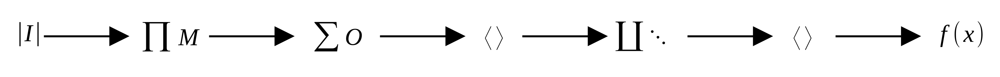
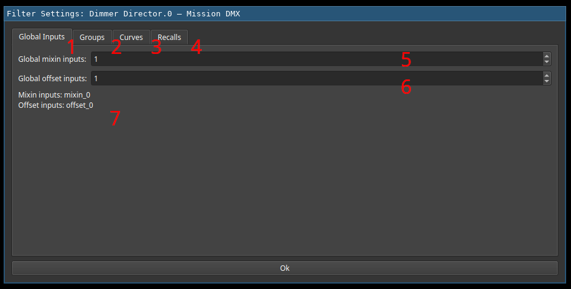
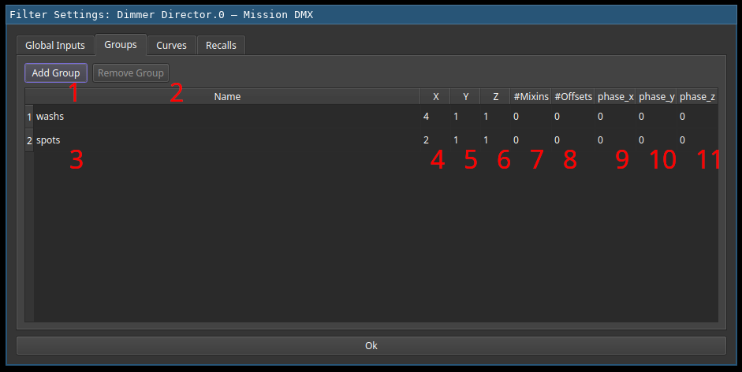
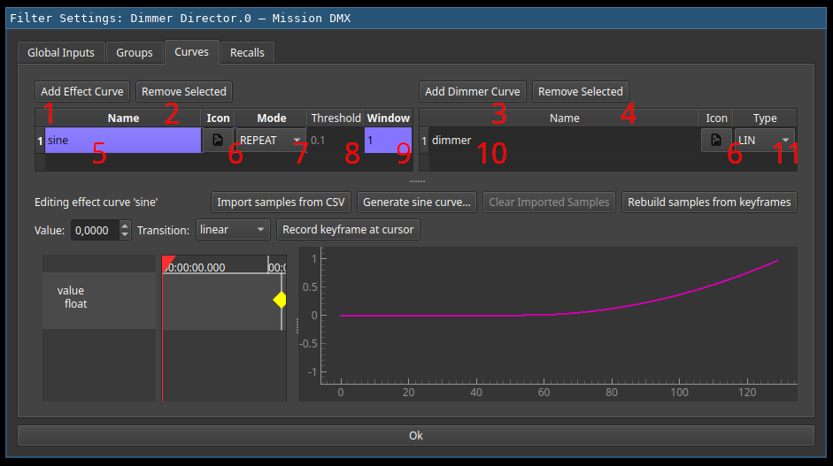
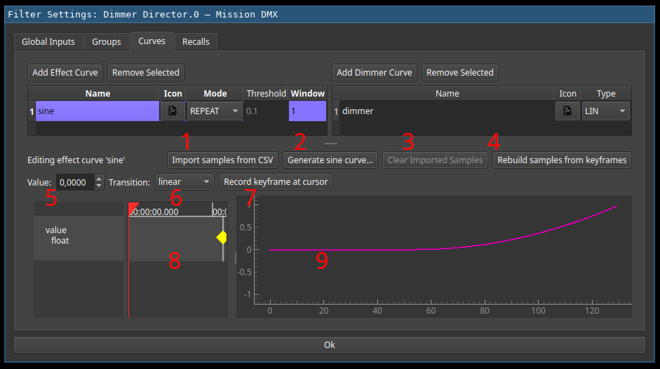
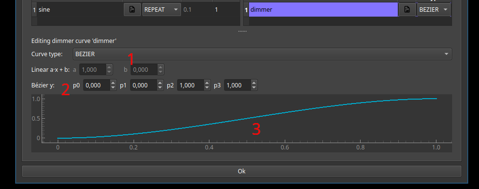
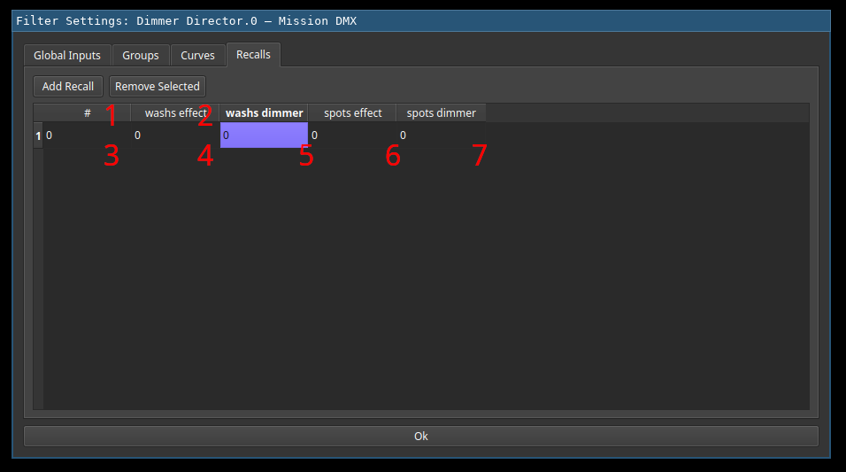

# Dimmer Director Filter

This document describes how to use the dimmer director filter.

## How it works

The filter takes *n* groups of X/Y/Z dimmer channels as input. The channels of a
group are addressed by spatial coordinates: a group might, for example, hold
3×2×6 channels, with a single channel addressed as `groupname_X_Y_Z`. The output
is not a scalar but a three-dimensional vector.

For each group — configured globally, but applied per group — the filter accepts
a configurable number of dimmers, which will be mixed as well as offset. A
global mixin or offset is applied to all channels; a local one is specific to a
single channel, and if local ones are configured, they exist for each input
channel independently.

### Signal processing

The filter operates on floats; the signal flow is shown in the figure. The group
inputs — the values put into the filter — are normalized to [0, 1] first, then
mixed (multiplied). Next, offsets are applied (added) and the results are
clamped to [0, 1]. In a final stage, the effect engine is applied, creating the
outputs from these values.

### Effect engine

For each group, the effect engine generates the output by multiplying the
channel value with the selected effect curve (a float keyframe between -1 and
1). The effect is applied to each channel atomically, with the time argument
shifted by that channel's X/Y/Z phase. Effect curves can be configured to be
repeated or to be started based on a value change above a configurable threshold
(default: 10%); the threshold is measured against a window of previous values. A
currently running triggered effect curve is not restarted until the input value
has stopped changing — the curve finishes first and then holds its last value
(it always uses the current input value, of course). The result is clamped to
[0, 1]. Finally, the dimmer curve function (for example Lin, Sig, or a custom
Bézier) is applied for each output.

## Configuring the Filter

The filter can be configured using four tabs (see the next image):
 * Global Inputs (1)
 * Dimmer Groups (2)
 * Dimmer and Effect Curves (3)
 * Recalls (4)

### Inputs Tab

The gloabl inputs tab configures global mixins and offsets that are applied to all dimmer groups.
A mixin is treated as a multiplication (where `255`, `65535`, and `1.0` are treated as `100%` for their respective data type) of the brightness.
The offset brightness inputs are added.
The number of mixin inputs can be controlled using (5) and offsets using (6).
A summary ov available inputs is presented at (7).

### Groups Tab

The groups tab defines the groups of channels this filter produces. Every row of
the table describes one group; *Add Group* (1) appends a new one (its name is
queried in a dialog) and *Remove Group* (2) drops the currently selected row.
Removing a group also prunes the corresponding entries from every saved recall.

Each row has nine editable columns:

 * **Name** (3) — the identifier used both as the prefix of all output channels
   of this group (`<name>_X_Y_Z`) and as the name of the group's main dimmer
   input channel. The name must be unique within this filter, must be non-empty,
   and may only contain ASCII letters, digits, single underscores and hyphens.
   Double underscores and trailing underscores are rejected.
 * **X** (4), **Y** (5), **Z** (6) — the three spatial extents of the group.
   Each must be at least `1`. The group ultimately produces `X · Y · Z` output
   channels, one per spatial position.
 * **#Mixins** (7), **#Offsets** (8) — the number of per-group mixin and offset
   inputs the group requires. These are exposed as input channels
   `mixin_<name>_<j>` and `offset_<name>_<l>` in addition to the global mixins
   and offsets configured on the Global Inputs tab.
 * **phase_x** (9), **phase_y** (10), **phase_z** (11) — integer tick offsets
   applied to the effect-curve lookup for a cell with coordinates `(x, y, z)`.
   Fish evaluates the effect curve at index
   `tick + phase_x·x + phase_y·y + phase_z·z`; non-zero phases are what let a
   group's channels sweep through the curve at different offsets instead of all
   pulsing in sync.

### Curves Tab

The curves tab defines the pools of effect curves (left table) and dimmer
curves (right table) that may be activated per group at runtime. Each group
picks exactly one of each at any point in time; recalls (see the Recalls tab)
store pairs of indexes into these two tables.

The buttons above the tables are *Add Effect Curve* (1) and *Remove Selected*
(2) for the effect-curve pool, and *Add Dimmer Curve* (3) and *Remove Selected*
(4) for the dimmer-curve pool. Only one row across the two tables may be
selected at a time: selecting a row in the effect-curve table clears any
selection in the dimmer-curve table and vice versa, so the editor beneath the
tables (see sub-sections) always targets the just-selected curve.

The columns of the effect-curve table are:

 * **Name** (5) — human-readable identifier used by the runtime UI widget and
   recall tooltips; not consumed by fish itself.
 * **Icon** (6) — opens the asset picker. The chosen image becomes the icon of
   the corresponding button in the runtime UI widget.
 * **Mode** (7) — `REPEAT` loops the curve forever once activated; `TRIGGER`
   plays it once when the group's normalised input delta exceeds *threshold*
   across the last *window* ticks and then holds the last sample until the
   input settles again.
 * **Threshold** (8) — the fraction of the normalised input range that must be
   crossed to retrigger a `TRIGGER`-mode curve. The field is disabled (greyed
   out) for `REPEAT` curves because fish does not consult it in that mode.
 * **Window** (9) — the number of previous update ticks used to compute the
   trigger delta. Fish clamps the value to a minimum of `1`.

The columns of the dimmer-curve table are:

 * **Name** (10) — human-readable identifier; see above.
 * **Icon** (6) — same asset picker as the effect-curve table.
 * **Type** (11) — `LIN`, `SIG` or `BEZIER`; selects one of the three response
   functions fish supports.

Row-specific parameters are not shown in the tables themselves; they live in
the curve editor below the tables, which switches between the effect-curve
editor and the dimmer-curve editor depending on which row is currently selected.

#### Effect Curves

An effect curve is the per-tick signal that modulates every output channel of
a group. Its ground truth is either a keyframe track or an imported sample
list; fish only sees the resolved sample list.

The button row above the editor controls which of the two sources is active:

 * *Import samples from CSV* (1) opens a file dialog that defaults to the
   user's home directory and reads a comma- or newline-separated list of
   floats; values are clamped to the range fish accepts. The import drops any
   existing keyframes.
 * *Generate sine curve...* (2) opens a modal dialog where the amplitude,
   offset, frequency and phase of a sine wave can be chosen. The dialog
   produces exactly one period's worth of samples so continuous looping is
   seamless; values outside `[0, 1]` are clamped. The result replaces the
   current sample list and clears the keyframes.
 * *Clear Imported Samples* (3) drops the current CSV- or sine-imported sample
   list, re-enables keyframe editing and empties the keyframe list.
 * *Rebuild samples from keyframes* (4) explicitly re-samples the current
   keyframe list into the sample cache. The editor runs this automatically on
   a background thread whenever the user switches to another curve or closes
   the settings dialog, so this button is only needed when the preview needs
   to update immediately after a manual edit.

Keyframes are recorded through the controls at (5)–(7): the *Value* spin box
(5) selects the y value of the new keyframe (in `[-1, 1]`); the *Transition*
combo (6) picks one of fish's five supported transitions (edge, linear,
sigmoidal, ease in, ease out); and *Record keyframe at cursor* (7) appends a
keyframe at the current cursor position of the timeline using those two values.

The timeline widget (8) displays the current keyframe list on a single
floating-point channel and lets the user drag the time cursor to the desired
record position. The sample preview plot (9) shows the resolved sample list
that fish will consume — it refreshes automatically whenever the sample cache
is rebuilt, including after background resamples finish.

When the active curve has imported samples (so there are no keyframes to
edit), the timeline is disabled and a help text explains how to drop the
imported samples via *Clear Imported Samples* before resuming keyframe
editing. The sample preview (9) stays visible in both modes.

#### Dimmer Curves

Dimmer curves shape the normalised output after the effect curve has been
applied. Each curve has three parts: the *Curve type* combo (1), the
type-specific parameter row (2) and the response preview plot (3).

The *Curve type* combo (1) selects between the three fish-supported response
functions:

 * `LIN` applies the affine function `f(x) = a·x + b`, with the output clipped
   to `[0, 1]`. The two parameters `a` and `b` are exposed in the *Linear
   a·x + b* row of (2); the defaults `a = 1, b = 0` reproduce the identity.
 * `SIG` has no parameters: fish applies a steepened logistic centred at `0.5`
   that pulls low values further down and high values further up for a
   contrastier response.
 * `BEZIER` is a cubic Bézier on `[0, 1] → [0, 1]` with `t = x`; the four
   control-point y values `p0`..`p3` are exposed in the *Bézier y* row of (2).
   The x coordinates are implicit, so the parameters shape only the vertical
   response.

Only the parameter row matching the current type is enabled; the other rows
are greyed out. Switching a curve's type reseeds the parameter list to the
matching defaults (`[1, 0]` for `LIN`, `[]` for `SIG`, `[0, 0, 1, 1]` for
`BEZIER`) so that leftover values from the previous type cannot be
accidentally reinterpreted.

The response preview plot (3) renders `y = f(x)` for `x ∈ [0, 1]` and refreshes
live while the parameters are edited.

### Recalls Tab

Recalls are named combinations of (effect curve, dimmer curve) pairs — one
pair per group — that can be activated as a single operator action from the
runtime UI widget. *Add Recall* appends a new row (its selections default to
`(0, 0)` for every group); *Remove Selected* drops the currently selected row.

The table has one row per saved recall. The *#* column (1) shows the recall
index the runtime UI widget uses to address the recall and is not editable.
After the recall index, the table has a pair of columns (2) for every group
configured on the Groups tab, storing the effect-curve index and the
dimmer-curve index to apply to that group when the recall is triggered. The
screenshot shows two example groups, but the number of column pairs always
matches the number of groups.

(3) marks the recall index cell of the first row. The cells following it
alternate per group between the effect-curve index (4) and the dimmer-curve
index (5) of the first group, then the effect-curve index (6) and
dimmer-curve index (7) of the second group, and so on for each additional
group. Index cells are plain integers; values that fall outside the current
curve pool are clamped to the first curve when the recall is applied at
runtime, so trimming the curve pool later never fails a recall. Column
headers rename, appear and disappear automatically as groups are renamed,
added or removed on the Groups tab, and every recall row grows or shrinks
the matching number of cells.

## Show UI Widget

TODO create screenshot

TODO explain usage of show UI widget
