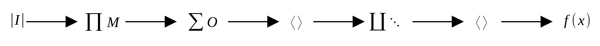

# Dimmer Director Filter

This document describes how to use the dimmer director filter.

## How it works

The filter takes *n* groups of X/Y/Z dimmer channels as input. The channels of a
group are addressed by spatial coordinates: a group might, for example, hold
3×2×6 channels, with a single channel addressed as `groupname_X_Y_Z`. The output
is not a scalar but a three-dimensional vector.

For each group — configured globally, but applied per group — the filter accepts
a configurable number of dimmers, which will be mixed as well as offset. A
global mixin or offset is applied to all channels; a local one is specific to a
single channel, and if local ones are configured, they exist for each input
channel independently.

### Signal processing

The filter operates on floats; the signal flow is shown in the figure. The group
inputs — the values put into the filter — are normalized to [0, 1] first, then
mixed (multiplied). Next, offsets are applied (added) and the results are
clamped to [0, 1]. In a final stage, the effect engine is applied, creating the
outputs from these values.

### Effect engine

For each group, the effect engine generates the output by multiplying the
channel value with the selected effect curve (a float keyframe between -1 and
1). The effect is applied to each channel atomically, with the time argument
shifted by that channel's X/Y/Z phase. Effect curves can be configured to be
repeated or to be started based on a value change above a configurable threshold
(default: 10%); the threshold is measured against a window of previous values. A
currently running triggered effect curve is not restarted until the input value
has stopped changing — the curve finishes first and then holds its last value
(it always uses the current input value, of course). The result is clamped to
[0, 1]. Finally, the dimmer curve function (for example Lin, Sig, or a custom
Bézier) is applied for each output.

## Configuring the Filter

### Inputs Tab

### Groups Tab

### Effects Tab

### Dimmer Curves Tab

### Recalls Tab

## Show UI Widget
